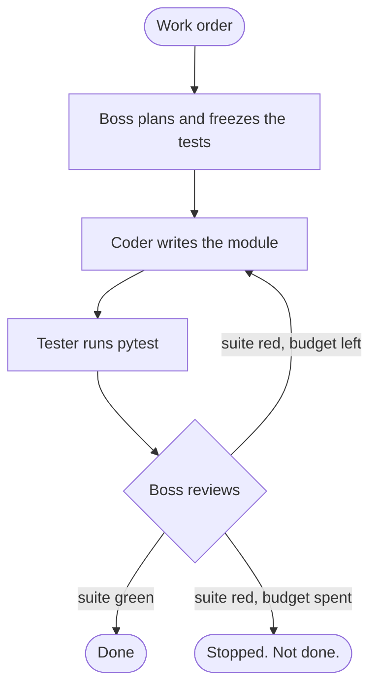

# BossLoop

A strict boss, a coder, and a tester. They share one work order. They do not stop because a draft looks plausible. They stop when the tests pass.

BossLoop is a small, production-shaped multi-agent loop for Khaja Mujahiddin Mohammed's portfolio. The boss owns the contract. The coder writes only the module. The tester runs that contract with pytest and reports the counts that actually came back. A policy gate, not the model's mood, decides whether the crew is done. Every step is written to disk, so a run can resume after a crash or a closed laptop.

The rehearsed job is a tiny Python module called `textkit`: count words, list unique words, and check palindromes. The offline crew gets the first draft wrong on purpose. The boss sends it back. The second draft passes. No API key is required to watch that happen.

## The problem this solves

A single model asked to "write the code and the tests" can bless its own homework. The suite goes green because the tests were written to match the bug. BossLoop splits the job the way a careful team does.

- The boss writes the plan and the acceptance tests, then freezes them.
- The coder may change the module and nothing else.
- The tester does not grade by vibes. It runs pytest in a clean folder and reads the junit report.
- If the boss says "ship it" while the suite is red, the policy gate overrules that and sends the module back.
- If the suite is green, the gate accepts the work even if the boss hesitates.
- If the iteration cap arrives with a red suite, the run stops and is recorded as not done.

That is the whole product: a cyclic crew with a boss who cannot wave a failing build through.

## How a run moves



The same picture is a [LangGraph](https://github.com/langchain-ai/langgraph) `StateGraph`: nodes named `plan`, `code`, `test`, and `review`, with an edge from `review` back to `code`. Agent inputs and outputs are Pydantic models. The graph state is checkpointed to `runs/<run-id>/state.json` after every node, plus a step file for the timeline.

## How people use it

1. Run the offline demo and read the transcript. You should see a red suite, a revise order, a second draft, and an accept.
2. Open the dashboard and press **Play the loop** to watch the same run as a timeline. Locally, **Run the offline demo** starts a fresh crew.
3. Resume a run that was paused. The next node picks up from the checkpoint. Finished plans are not written again.
4. Give the crew a different small module by setting `OPENAI_API_KEY` or `GEMINI_API_KEY` and using `bossloop run`. The demo command stays on the mock crew so a portfolio machine never spends a key by accident.

The tester executes the generated module on your machine, inside that run's workspace, with a 30 second timeout. Point it at work you are willing to run.

## Live dashboard

The hosted timeline replays a finished offline run, including the red first draft and the green second draft:

**https://multi-agent-team-virid.vercel.app**

`bossloop dashboard` on your own machine is the interactive board. It can launch the offline crew and resume a checkpoint. The hosted page is the public replay, so it stays up with no API key and no long-running worker.

## Quickstart

```bash
python -m venv .venv
source .venv/bin/activate
pip install -e .
bossloop demo
bossloop dashboard
```

Open http://127.0.0.1:8000 . The dashboard binds to localhost.

Useful commands:

```bash
bossloop demo                     # rehearsed textkit job, always offline
bossloop list
bossloop show <run-id>
bossloop resume <run-id>          # continue a halted checkpoint
bossloop run "Describe a small Python module."
```

`bossloop demo` exits 0 when the boss accepts a green suite.

## Keys, when you want a live model

Copy `.env.example` to `.env`. Leave both keys blank for the offline demo.

| Variable | Role |
| --- | --- |
| `OPENAI_API_KEY` | Used by `bossloop run` when set. Preferred over Gemini. |
| `OPENAI_MODEL` | Defaults to `gpt-4o-mini`. |
| `GEMINI_API_KEY` | Used when OpenAI is unset. |
| `GEMINI_MODEL` | Defaults to `gemini-2.5-flash`. |
| `BOSSLOOP_RUNS_DIR` | Checkpoint folder. Defaults to `./runs`. |

`bossloop run` chooses a provider with `--provider auto|mock|openai|gemini`. `auto` picks OpenAI, then Gemini, then the mock crew. The mock crew only rehearses the textkit work order. A custom order without a key stops immediately and says so, instead of pretending to build it.

Live calls go to the provider's JSON HTTP API. The boss, coder, and reviewer each return a Pydantic object. The tester's pass/fail bit still comes from pytest.

## What gets saved

```text
runs/<run-id>/state.json          # resume point
runs/<run-id>/steps/01-plan.json  # one file per node
runs/<run-id>/workspace/          # module, frozen tests, pytest output
```

`runs/` is gitignored. `site/sample_run.json` is a published copy of one green demo so the dashboard has something to show before you run anything.

## Repository layout

```text
src/bossloop/          crew, LangGraph cycle, CLI, FastAPI board
site/                  dashboard and the recorded run
tests/                 policy gate, pytest runner, full offline loop, resume, API
.github/workflows/ci.yml
```

## Tests and CI

GitHub Actions installs the package, runs pytest, and runs `bossloop demo` on Python 3.12. No secrets. The offline demo has to finish green.

[](https://github.com/khajamujahid/multi-agent-team/actions/workflows/ci.yml)

```bash
pytest
```

## License

[MIT](LICENSE). Copyright 2026 Khaja Mujahiddin Mohammed.

## Author

Khaja Mujahiddin Mohammed

- Portfolio: https://portfolio-one-theta-71.vercel.app/
- GitHub: https://github.com/khajamujahid
- This repo: https://github.com/khajamujahid/multi-agent-team
